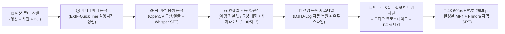
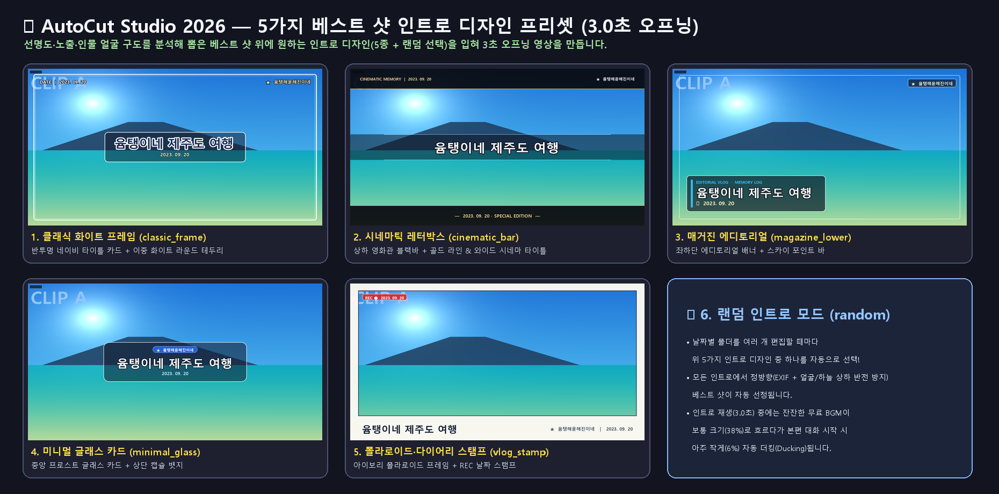
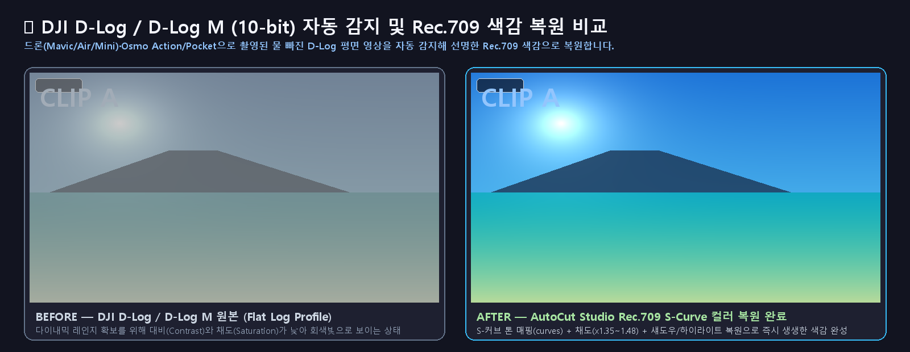

# 🎬 AutoCut Studio 2026

> **"일일이 컷 편집하기 귀찮아서 만들었어요."**  
> 영상과 사진의 메타데이터·비전(흔들림/선명도/얼굴)·음성(한국어 대화)을 스스로 분석해서, **기본 컨셉(`여행`, `그냥 대화` 등)만 골라주면 알아서 컷 편집·색보정(DJI D-Log)·자막·트랜지션·배경음악·4K 60fps HEVC 인코딩까지 끝내주는 AI 자동 영상 편집 스튜디오**입니다.

- **Author GitHub**: [https://github.com/geniuth](https://github.com/geniuth)
- **Repository**: [https://github.com/geniuth/autocut](https://github.com/geniuth/autocut)

---

## 💡 1. 왜 만들었나요? (제작 동기)

여행을 다녀오거나 아이들과 일상을 보내고 나면 스마트폰, 액션캠, 드론(DJI)에 수십~수백 개의 동영상과 사진이 쌓입니다.  
막상 추억 영상으로 남기려고 편집 프로그램을 켜면:
1. 영상을 하나씩 돌려보며 **바닥이 찍히거나 심하게 흔들린 구간, 아무 말 없는 침묵 구간을 일일이 자르고**,
2. **사진과 동영상 촬영 순서를 맞추고**, 뒤집힌 사진 방향을 바로잡고,
3. 대화 소리를 들어보며 **자막을 타이핑하고**,
4. **배경음악(BGM)**을 깔아둔 뒤 말할 때는 줄이고 사진 나올 때는 키우는 볼륨 키프레임을 찍고,
5. **DJI D-Log**로 찍은 물 빠진 영상을 일일이 색보정(LUT)하는 과정이 **너무 번거롭고 귀찮아서** 결국 원본 파일을 외장하드에 방치하게 됩니다.

그래서 **"폴더만 지정하고 기본 컨셉(`여행` 또는 `그냥 대화`)만 선택하면, AI가 알아서 다 분석해서 4K 60fps 완성본 영상과 필모라(Filmora) 프로젝트용 파일까지 원클릭으로 만들어주는 프로그램"**을 직접 만들었습니다.

---

## 🧠 2. 핵심 컨셉 (알아서 분석하고 편집·인코딩하는 파이프라인)

사용자는 **촬영 폴더**와 **편집 모드(컨셉)**만 선택하면 됩니다. 나머지는 엔진이 전 과정을 자동으로 수행합니다.



### ✂️ 영상 편집 모드 (4가지 기본 컨셉 지원)
| 편집 모드 | 설명 및 컷 편집 알고리즘 |
| :--- | :--- |
| **🏝️ 여행 (기본값, `travel`)** | **풍경·인물 베스트 컷 + 현장 대화의 조화** — 대화 구간은 문장이 끊기지 않게 살리고(앞뒤 `0.5초` 여유), 말 없는 구간도 선명하고 안정적인 풍경·인물 하이라이트(`최대 6.5초`)를 골라 여유 있게 연결합니다. |
| **💬 그냥 대화 (`talk`)** | **일상 토크·가족 대화 중심** — 말소리(Speech)가 있는 모든 구간을 최우선으로 보존하며(`0.6초` 여유, 인접 대화 자동 병합), 말 없는 침묵 구간은 핵심 표정·리액션 위주로 짧게(`최대 2.5초`) 덜어내어 텐션감 있게 대화를 이어 붙입니다. |
| **⚡ 하이라이트 요약 (`highlight`)** | **핵심 대화 + 베스트 장면 빠른 템포** — 긴 원본 영상을 3~5분 내외로 빠르게 요약할 때 적합합니다 (`최대 무음 컷 3.5초`). |
| **🚗 드라이브·풍경 감상 (`drive`)** | **이동·해안도로·풍경 롱테이크 비중 확대** — 대화뿐만 아니라 흔들림 없이 안정적인 주행·자연 풍경 구간을 길게(`최대 9.0초`) 살려 감상용으로 편집합니다. |

### 📏 편집 길이 상한 (v2.6.0 — 기본 원본의 60% 이하)
어떤 모드든 **편집된 영상 길이는 원본 영상 전체 길이의 60% 이하**로 맞춥니다 (`출력 화질` 카드의 `편집 길이 상한`에서 40~80% 또는 `제한 없음` 선택, 사진 3초 슬라이드는 계산에서 제외). 상한을 넘으면 손실이 적은 순서로 줄입니다.
1. 말소리 없는 구간을 2.5초까지 줄이기 (점수 낮은 것부터)
2. 대화 구간 앞뒤의 무음 여백을 0.4초까지 줄이기
3. 한 영상에 여러 구간이 있으면 가장 좋은 구간만 남기기
4. 그래도 넘으면 점수 낮은 영상부터 제외 (말소리 없는 영상 먼저)

점수 = 말소리 비율 × 3 + 미학 점수 + VLM 하이라이트 점수. 분석 리포트에는 원래 선택 구간이 그대로 남아, 상한을 바꿔 다시 돌리면 원본 분석에서 다시 계산합니다.

### 🎨 HDR 자동 색 균형 (v2.9.0 · 기본 켜짐)
오즈모 포켓3 등 HLG로 찍은 영상은 검정이 떠서 뿌옇고 채도가 낮으며 클립마다 밝기·채도가 들쭉날쭉한 경우가 많습니다 (실측: 오즈모 HLG 채도 25~67·검정 20~39, 아이폰 HLG 채도 75·검정 8). `HDR 영상 자동 색 균형` 옵션은 HDR 클립마다:
1. 키프레임 6장을 뽑아 **검정 낮추기 × 대비** 후보 12개를 실제로 렌더링해, 검정이 깊지만 뭉개지지 않고 하이라이트가 날아가지 않는 값을 고르고,
2. **채도(공통 목표치로 맞춤) × 감마** 후보와 원본을 **CLIP 미학 점수(LAION-Aesthetics)**로 채점해 가장 보기 좋은 값을 고릅니다 (원본도 후보라 나빠지지 않음).

클립당 한 가지 값이라 깜빡임이 없고, 목표치가 같아 클립끼리 톤이 맞춰집니다. HDR을 유지한 채 `libplacebo`(brightness·contrast·saturation·gamma)로 적용되어 HLG·SDR 출력 모두에 쓰이고, 인트로 베스트샷에도 반영됩니다. 결과는 `편집결과_<날짜>/<날짜>_자동색보정.json`에 캐시됩니다 (클립당 약 5초, 처음 한 번). 실측(오즈모 포켓3 3클립): 평균 채도 40→60, 검정 32→18, 미학 점수 4.23→4.43, 하이라이트 클리핑 감소.

### ✨ 마무리 보정 (v3.0.0 · FilmCraft 참고)
화면 오른쪽 `3.` 카드의 `✨ 마무리 보정` 다섯 가지입니다. 결과는 모두 `편집결과_<날짜>/` 안의 JSON에 캐시돼 다시 돌릴 때는 바로 넘어갑니다.

| 옵션 | 기본 | 하는 일 |
| :--- | :---: | :--- |
| **기기 간 색 맞춤** | 켜짐 | 시청자가 보는 화면(HDR은 톤매핑·자동 색 균형 후) 기준으로 클립마다 어두운·중간·밝은 영역의 색(Oklab)과 채도를 재고, **같은 시간대(±15분)에 찍힌 클립들의 중간값** 쪽으로 70% 맞춥니다. 같은 순간을 아이폰·고프로·픽셀로 찍었을 때 색온도가 달라 보이는 문제를 줄이고, 실내 저녁(따뜻함)과 바닷가 낮(푸름)처럼 장면이 다른 건 그대로 둡니다. 피부색이 8° 이상 돌아가면 보정을 약하게 하고, 보정은 클립별 3D LUT(`lut3d`)로 적용해 HLG 10-bit에도 그대로 쓰입니다. 실측(제주 1일차 18클립): 주변 클립과의 색차 0.74 → 0.28. 캐시 `<날짜>_컬러매치.json` |
| **클립 음량 맞춤** | 켜짐 | 파일마다 통합 음량(BS.1770, LUFS)을 한 번 재서 **-16 LUFS가 되도록 클립 하나에 고정 게인**(-12 ~ +10 dB)을 줍니다. 예전엔 컷마다 `loudnorm`을 따로 걸어 같은 장면이 컷마다 커졌다 작아졌다 했고 작은 소리도 큰 소리만큼 키워졌는데, 이제 장면 안의 강약이 그대로 남습니다. 피크는 `alimiter`(-1.5 dBTP)로만 잡습니다. 캐시 `<날짜>_음량.json` |
| **손떨림 보정(폰)** | 꺼짐 | 휴대폰 영상의 컷만 `vid.stab` 2패스로 안정화합니다. 짐벌(DJI·오즈모)·액션캠(고프로·Insta360)은 이미 안정화돼 건너뛰고, 흔들림(고주파 RMS)이 화면 폭의 0.3% 미만인 컷도 그대로 둡니다(안정화는 화면을 살짝 확대하므로). 흔들림 측정은 960px로 줄여 하고 변환값을 원본 해상도로 키워 빠릅니다. vid.stab은 8-bit 전용이라 HLG 출력의 HDR 원본 컷은 제외됩니다. |
| **세로 쇼츠 9:16** | 꺼짐 | 완성본에서 **1080×1920 세로 영상**(`<날짜>_세로쇼츠_9x16.mp4`)을 추가로 만듭니다. 얼굴 검출(YuNet)로 사람을 따라가고 얼굴이 없으면 시각 주목도(saliency) 쪽으로 기울이며, 샷 안에서는 1초 가우시안으로 부드럽게, 컷마다 새로 조준합니다. 세로로 넣었던 폰 영상의 검은 여백은 화면에 들어오지 않게 하고, 인트로 제목 카드는 빼고 시작하며, 위쪽 날짜·로고 띠를 잘라낸 뒤 세로용 날짜·로고를 다시 얹습니다. 코덱·HLG 여부는 완성본과 같습니다. |
| **화자 구분(실험적)** | 꺼짐 | 문장마다 화자 임베딩(**WavLM-Base-Plus-SV**, 처음 쓸 때 약 400MB 다운로드)을 뽑아 폴더 전체를 묶고, `[화자 N]`이 붙은 `<날짜>_화자자막(필모라용).srt`를 만듭니다(2명 이상일 때). 자막을 영상에 입히면 화자별로 글자색이 다릅니다. 가족 대화처럼 말이 겹치고 아이 목소리가 섞이면 틀릴 수 있어 실험적 기능입니다. (MFCC 방식은 여러 클립에서 목소리보다 장소·마이크로 묶여 쓰지 않았습니다.) 캐시 `<날짜>_화자분석.json` |

---

## ✨ 3. 인트로 종류 (5가지 디자인 + 랜덤 선택)

전체 영상과 사진 중 **초점 선명도(Laplacian Variance), 노출 밸런스, 색채 채도, 인물 얼굴 구도(Haar Cascade), 상하 정방향 여부**를 종합 채점해 가장 잘 나온 **베스트 샷(Best Shot)**을 뽑아 **3.0초 오프닝 인트로**를 생성합니다.  
취향에 따라 **5가지 인트로 디자인 중 하나를 직접 고르거나 `랜덤`으로 선택**할 수 있습니다.



1. **클래식 화이트 프레임 (`classic_frame` — 기본값)**: 정방향 베스트 샷 위에 이중 화이트 라운드 프레임과 반투명 네이비 타이틀 박스를 배치한 깔끔한 디자인
2. **시네마틱 레터박스 (`cinematic_bar`)**: 영화관 비율의 상·하단 블랙 레터박스와 골드 라인, 중앙 와이드 시네마 타이틀을 배치한 영화풍 오프닝
3. **매거진 에디토리얼 (`magazine_lower`)**: 화면 중앙의 피사체를 가리지 않도록 좌측 하단에 스카이 포인트 라인과 매거진 배너 카드를 배치한 감성 디자인
4. **미니멀 글래스 카드 (`minimal_glass`)**: 모던한 반투명 프로스트 글래스 카드와 상단 블루 캡슐 로고 뱃지를 조합한 트렌디 디자인
5. **폴라로이드·다이어리 스탬프 (`vlog_stamp`)**: 따뜻한 아이보리 폴라로이드 액자 테두리와 좌상단 `REC ● 날짜` 스탬프, 하단 다이어리 캡션을 넣은 브이로그 디자인
6. **랜덤 인트로 스타일 (`random`)**: 날짜 폴더를 편집할 때마다 위 5가지 디자인 중 하나를 자동으로 선택

---

## 🔀 4. 트랜지션 (상황별 자동 선택 · 실제 영상 겹침 · 오디오 크로스페이드, v2.5.0)

예전에는 15종 중 무작위로 고르고, 앞 클립 **마지막 프레임을 멈춘 사진**에서 디졸브했습니다. v2.5.0부터는:


1. **실제 영상끼리 겹침 (핸들)**: 각 컷을 렌더링할 때 아웃 지점 뒤의 원본 0.25~0.7초를 같은 필터(색보정·HDR 톤매핑·회전·HUD·음량)로 함께 뽑아, 다음 컷 시작부와 겹칩니다. 전환 중에도 앞 장면이 계속 움직이고, 전체 길이는 그대로라 자막 싱크가 유지됩니다. (사진·원본 끝 컷은 기존처럼 마지막 프레임 사용)
2. **상황별 선택**: 촬영 시각·파일을 보고 고릅니다.

| 상황 | 여행/드라이브 | 그냥 대화 |
| :--- | :--- | :--- |
| 같은 영상 안의 점프컷 | 짧은 필름 디졸브(0.3초) 또는 컷 | 컷 |
| 같은 장면 (20분 이내) | 필름 디졸브(0.45초) | 대부분 컷 |
| 장면 전환 (20분 이상·다른 날) | 화이트 딥 · 라이트 릭 · 휩 팬 (드라이브는 휩 팬 위주) | 블랙 딥 |
| 사진 앞뒤 | 필름 디졸브(0.5초) | 필름 디졸브 |
| 인트로 → 첫 장면 | 필름 디졸브(0.6초) | 필름 디졸브 |

   - 스타일 프리셋이 **빠른 텐션**(평균 컷 4.5초 미만)이면 휩 팬·화이트 딥 위주, **시네마틱**이면 블랙 딥·라이트 릭 위주입니다. 프리셋의 `transition_prob`는 같은 장면 디졸브 빈도로 쓰입니다.
   - **휩 팬**: 가속·감속하는 밀어내기 + 모션 블러, **라이트 릭**: 오른쪽 위에서 번지는 따뜻한 빛 + 디졸브 (`xfade` 커스텀 수식).
3. **오디오 크로스페이드**: 영상 컷이 끝날 때마다 0.25초 동안 앞 소리와 뒤 소리를 겹쳐 '틱' 소리와 뚝 끊김을 없앱니다. 배경음악은 양쪽이 같은 신호라 음량 변화 없이 이어집니다.

마지막 장면에는 `1.2초` 블랙 페이드아웃이 자동 적용됩니다.

---

## 🚁 5. DJI 드론·액션캠 & D-Log / D-Log M 자동 색보정

DJI 드론(Mavic 3 / Air 3 / Mini 4 Pro 등)이나 Osmo Action / Osmo Pocket으로 촬영한 **D-Log / D-Log M (10-bit)** 영상은 후보정을 전제로 촬영되어 원본 그대로 두면 물 빠진 회색빛(Flat)으로 보입니다.



- **자동 감지 (`auto` — 기본값)**: 파일명(`DJI_*`), FFprobe 컬러 메타데이터, **10-bit 픽셀 포맷(`yuv420p10le`)**, 프레임 평균 대비(`std < 43`) 및 채도(`sat < 68`)를 분석해 **D-Log / D-Log M 영상만 골라서 자동으로 Rec.709 S-커브 톤 매핑과 채도 복원 필터를 적용**합니다. (일반 스마트폰 영상과 한 폴더에 섞여 있어도 D-Log 영상만 정확히 복원합니다!)
- **수동 강제 지정도 지원**: `DJI D-Log M (10-bit) 전용 복원`, `DJI D-Log (Mavic/Air 프로파일) 복원`, `액션캠/고프로 Flat 생생하게` 중 직접 선택 가능

---

## 🎵 6. 배경음악 (BGM 자동 생성 & 스마트 볼륨 더킹)

유튜브 업로드 시 저작권 걱정 없이 사용할 수 있는 **잔잔한 어쿠스틱 피아노 & 앰비언트 패드 배경음악(`calm_family_bgm.wav`)**을 자체 신디사이저로 생성·내장하고 있으며, 클립 종류에 따라 **자동 볼륨 더킹(Dynamic Volume Ducking)**이 동작합니다.

- **동영상 클립 재생 중 (현장 대화 우선)**:
  - 현장 오디오의 주행 소음·바람 소리를 제거(`highpass=85Hz` + `afftdn`)하고 방송 표준 음압(`loudnorm -16 LUFS`)으로 맞춘 뒤, **배경음악은 `6%`로 아주 작게** 깔아 대화 소리가 선명하게 들리도록 합니다.
- **인트로(3초) 및 사진 슬라이드(3초) 재생 중 (감성 연출)**:
  - 현장 대화가 없는 구간이므로 **배경음악을 `38%` 보통 크기로 자연스럽게 키워** 앞뒤 페이드인/아웃과 함께 감성적인 분위기를 연출합니다.

---

## 📅 7. 동영상과 사진은 어떻게 배치하나요? (파일 내 메타데이터 분석)

폴더 안에 동영상(`.mp4`, `.mov`, `.mkv` 등)과 사진(`.jpg`, `.jpeg`, `.png`, `.heic` 등)이 섞여 있어도 파일 이름이 아닌 **파일 내부의 실제 촬영 시각 메타데이터**를 정밀 분석하여 **초 단위 시간순(Chronological Order)**으로 한 타임라인에 배치합니다.

1. **동영상 촬영 시각 추출 (`get_video_datetime_iso`)**:
   - `ffprobe`로 영상 컨테이너 내부의 `com.apple.quicktime.creationdate`(애플/아이폰 로컬 타임존 포함) 및 표준 `creation_time`(UTC 태그 감지 시 한국 시간 `KST +09:00`로 자동 변환)을 읽어 정확한 촬영 시각을 확보합니다.
2. **사진 EXIF 촬영 시각 추출 (`get_photo_datetime_iso`)**:
   - `Pillow`로 사진 내부의 `EXIF Tag 36867 (DateTimeOriginal)` 및 `Tag 306 (DateTime)`을 읽어 실제 셔터를 누른 시각을 추출합니다.
3. **상하 반전 자동 보정 & 블러 프레임**:
   - EXIF 회전 태그 보정(`ImageOps.exif_transpose`)은 물론, 메타데이터 없이 거꾸로 저장된 사진/영상도 **상·하단 하늘 밝기/블루 비율 및 정방향/역방향 얼굴 검출 비교**를 통해 위아래가 뒤집히지 않도록 자동 보정합니다.
   - 세로 사진이나 비율이 다른 사진은 배경에 은은한 가우시안 블러(`GaussianBlur`)와 화이트 테두리를 입혀 **3.0초 슬라이드 클립**으로 자연스럽게 이어 붙입니다.

---

## ⚙️ 8. 기본 출력 인코딩 사양 (4K 60fps HEVC 25Mbps)

고화질 원본 영상과 드론/아이폰 4K 촬영본의 디테일을 손실 없이 보존하기 위해 기본 출력 사양이 최고 수준으로 설정되어 있습니다 (GUI에서 언제든 변경 가능).

- **출력 해상도 ( 기본값 )**: `3840x2160 (4K UHD)` *(2560x1440 QHD, 1920x1080 FHD, 1280x720 HD 선택 가능)*
- **프레임 레이트 ( 기본값 )**: `60 fps` *(30 fps, 24 fps 선택 가능)*
- **압축 코덱 ( 기본값 )**: `HEVC (H.265 — NVIDIA NVENC 하드웨어 가속 hevc_nvenc + Apple/Windows 호환 hvc1 태그)`
- **출력 화질 ( 기본값 )**: `25,000,000 bps (25 Mbps)` *(평균 비트레이트 `-b:v 25M` + 최대 피크 `37.5M` VBR HQ 제어)*
- **다이내믹 레인지 (v2.8.0, `출력 화질` 카드의 `다이내믹 레인지`)**:
  - **SDR (기본)**: `Rec.709 8-bit` 마스터. HLG(아이폰 Dolby Vision 8.4 포함)·HDR10/HDR10+ 클립은 자동 감지되어 `libplacebo`(Vulkan GPU, 없으면 `zscale` CPU)로 톤매핑된 뒤 섞입니다.
  - **HLG HDR**: `BT.2020 10-bit HEVC Main10 HLG` 마스터. HLG 클립은 그대로, HDR10(PQ)은 HLG로 변환하고, SDR 영상·사진·인트로는 HDR 기준 백색(203nit, HLG 신호 약 75%)에 맞춰 변환해 밝기가 어울립니다. HDR TV·유튜브 HDR용이며, HLG라 HDR 미지원 화면에서도 자연스럽게 보입니다. HDR 원본 클립에는 8-bit 전용 스타일 색보정을 적용하지 않고, 화이트 딥은 블랙 딥으로 바뀌며(HDR 최대 밝기 섬광 방지), 자막은 SRT로만 제공합니다. H.264를 골라도 HEVC로 인코딩합니다.
  - 한 파일 안에서 클립별로 SDR/HLG/PQ를 바꿔 인코딩하는 것은 플레이어·유튜브가 지원하지 않아 불가능합니다.

---

## 🚀 9. 실행 방법 및 결과물

### 필수 환경
- Windows 10 / 11 (64-bit), Python 3.10+, FFmpeg (`hevc_nvenc` 지원 권장), NVIDIA GeForce RTX GPU 권장
- 주요 패키지 설치:
  ```bash
  pip install faster-whisper opencv-python pillow pillow-heif numpy scipy yt-dlp
  # 화자 구분(실험적)을 쓸 때만: pip install torch transformers
  ```

### 실행 방법
- **바탕화면 바로가기·작업 표시줄 아이콘 (v2.8.1)**: 바로가기는 `pythonw.exe "…utocut_gui.py"` + 아이콘 `assets/autocut_icon.ico` + 앱 ID(AppUserModelID) `YumTaeng.AutoCutStudio.2026`으로 만드세요. 앱 ID가 같아야 실행 중인 창이 고정한 바로가기에 묶여 카메라 아이콘으로 보입니다 (실행 중인 창을 바로 고정하면 `pythonw.exe`만 고정되어 파이썬 아이콘이 되고 클릭해도 AutoCut이 실행되지 않습니다). 아이콘은 16~256px 15가지 크기를 담고, 창 아이콘은 화면 배율에 맞는 정확한 크기로 설정해 200% 화면에서도 선명합니다.
- **작업 상태 저장 (v2.8.0)**: `Ctrl+S`를 누르면 작업 폴더에 `AutoCut_작업저장.autocut.json`(설정 + 타임라인)이 생기고, 그 폴더를 다시 고르면 불러올지 물어봅니다.
- **프로그램을 끄면 인코딩도 함께 종료** (v2.7.1): 편집 중에 창을 닫으면 확인 후 진행 중인 ffmpeg 인코딩을 즉시 멈추고 임시 작업 폴더를 지웁니다. 강제 종료·오류로 꺼져도 Windows 작업 개체(Job Object)가 ffmpeg를 함께 종료합니다 (Ollama 서버는 제외). 완성 파일은 `*.partial.mp4`로 쓰다가 끝나면 이름을 바꾸므로, 중간에 꺼져도 깨진 영상이 정상 이름으로 남지 않습니다.
- **하드웨어 사용률·로그 (v2.9.1)**: 맨 아래 상태 줄 오른쪽에 CPU·GPU0·GPU1(NVENC·VRAM)·NPU 사용률이 **숫자로** 항상 표시되고, `📈 사용률 그래프 창`을 체크하면 그래프가, `📋 로그 창`을 체크하면 실시간 분석·편집 로그가 별도 창(플로팅)으로 뜹니다. 끄거나 창의 ✕를 누르면 숨겨지고(로그는 숨겨져도 계속 기록), 창 위치는 다음 실행 때 복원됩니다.
- **좌측 상단 날짜 (v2.9.1)**: `좌측 상단 날짜` 칸에 적은 날짜가 영상 왼쪽 위와 인트로 제목 아래에 표시됩니다 (`20250920`, `2025.9.20`, `2025년 9월 20일` → `2025. 09. 20`, 그 밖의 글자는 그대로). 비워 두면 폴더 이름이 날짜일 때는 그 날짜, 아니면 폴더 안 가장 이른 촬영 날짜를 씁니다 (예: `에버랜드` 폴더 → 2025. 09. 20).
- 바탕화면 또는 폴더 내 **`AutoCut_Studio.vbs`** 더블클릭 (콘솔 창 없이 즉시 GUI 실행)
- 또는 터미널에서 직접 실행:
  ```bash
  python autocut_gui.py
  ```

### 생성되는 결과물 (`편집결과_날짜/` 폴더)
1. **`날짜_무자막_필모라용.mp4`** (항상 생성): 3초 인트로 + 시간순 영상/사진 컷 편집 + DJI D-Log 색보정 + 상황별 트랜지션(실제 영상 겹침) + 오디오 크로스페이드 + BGM 자동 더킹이 들어간 4K 60fps HEVC 완성 영상 (자막은 아래 SRT로 따로 제공 — 유튜브·플레이어·필모라에서 자막 파일로 불러오면 됩니다)
2. **`날짜_자막포함_완성본.mp4`** (옵션 · 기본 꺼짐, v2.7.0): `자막 입힌 완성본도 만들기`를 켠 경우에만 자막을 영상에 직접 입힌 버전을 추가로 만듭니다. 영상 전체를 한 번 더 인코딩하고 자막 렌더링이 CPU를 많이 써서 긴 영상은 수십 분이 더 걸립니다.
3. **`날짜_전체자막(필모라용).srt` & `날짜_음성자막(필모라용).srt`**: 필모라 타임라인에 드래그 앤 드롭하면 컷 편집 싱크에 100% 맞춰 올라가는 자막 파일
4. **`날짜_베스트샷.jpg`**: 3초 인트로에 선정된 정방향 베스트 샷 원본 이미지
5. **`날짜_편집분석리포트.json`**: 클립별 촬영 시각, 컷 구간, 음성 인식 결과를 담은 캐시 리포트 (사진 추가 후 재실행 시 기존 영상 분석을 1초 만에 통과!)
6. **`날짜_세로쇼츠_9x16.mp4`** (옵션 · 기본 꺼짐, v3.0.0): 얼굴을 따라가는 1080×1920 세로 버전
7. **`날짜_화자자막(필모라용).srt`** (옵션 · 기본 꺼짐, v3.0.0): `[화자 N]`이 붙은 음성 자막 (화자 2명 이상일 때)
8. **분석 캐시** `날짜_자동색보정.json` · `날짜_컬러매치.json` · `날짜_음량.json` · `날짜_화자분석.json`: 다시 돌릴 때 측정 단계를 건너뜀
