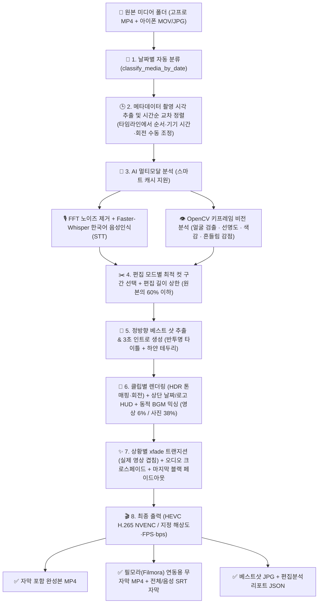
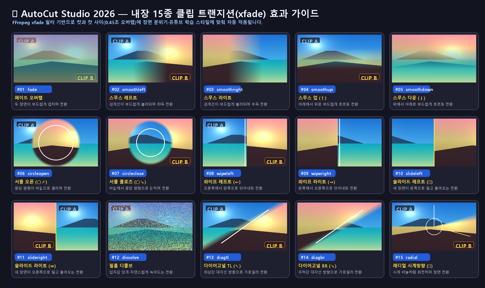

# 🎬 AutoCut Studio 2026 — AI 가족·여행·주행 영상 자동 편집 스튜디오

> **★ 윰탱해윤해진이네 에디션**  
> 고프로(GoPro)·아이폰(iOS)·일반 카메라로 촬영한 가족 여행 영상과 사진을 **촬영 시각(메타데이터) 순서대로 자동 정렬**하고, **AI 비전(얼굴/선명도/흔들림) + AI 한국어 음성인식(Faster-Whisper STT)**으로 베스트 구간만 컷편집·자막 생성·배경음악(BGM) 믹싱·HEVC(H.265) 하드웨어 가속 렌더링까지 원클릭으로 완성하는 데스크톱 스튜디오 프로그램입니다.

---

## 📁 1. 프로젝트 파일 구성

| 파일 / 폴더 | 역할 및 설명 |
| :--- | :--- |
| [`autocut_gui.py`](file:///d:/workspace/autocut/autocut_gui.py) | **메인 데스크톱 GUI 애플리케이션** (`1920x1080` 풀HD 다크 스튜디오 테마, 프리미어 스타일 스플래시 화면, 3단 카드형 UI, 실시간 CPU/GPU/VRAM 모니터 그래프, 유튜브 URL 학습기) |
| [`autocut_engine.py`](file:///d:/workspace/autocut/autocut_engine.py) | **핵심 AI 편집 엔진** (날짜별 분류, 메타데이터 시간순 정렬, OpenCV 비전/모션 스코어링, Faster-Whisper 한국어 STT, 베스트 샷 인트로 생성, 동적 BGM 더킹, HDR→SDR 톤매핑, 상황별 트랜지션·오디오 크로스페이드, FFmpeg HEVC NVENC 렌더링) |
| [`autocut_timeline.py`](file:///d:/workspace/autocut/autocut_timeline.py) | **프리미어식 하단 타임라인** (썸네일 클립 배치, 드래그 순서 변경, 기기 시간 보정, 클립 회전, `편집결과_<날짜>/<날짜>_타임라인순서.json` 저장) |
| `autocut_session.json` (자동 생성, git 제외) | 마지막 작업 상태(설정·선택 폴더) — 다음 실행 때 자동 복원 |
| `assets/autocut_icon.ico` / `.png` | 시네마 카메라 프로그램 아이콘 (창·작업 표시줄·스플래시) |
| [`AutoCut_Studio.vbs`](file:///d:/workspace/autocut/AutoCut_Studio.vbs) | **무콘솔(Windowless) 백그라운드 런처** (검은색 `cmd` 창 없이 즉시 GUI만 깔끔하게 실행) |
| [`AutoCut_Studio.bat`](file:///d:/workspace/autocut/AutoCut_Studio.bat) | 배치 파일 실행 런처 (`AutoCut_Studio.vbs` 호출) |
| [`custom_styles.json`](file:///d:/workspace/autocut/custom_styles.json) | 유튜브 URL 또는 로컬 레퍼런스 영상을 분석해 학습된 **맞춤형 편집 스타일 프리셋** 저장소 |
| [`assets/calm_youtube_free_bgm.wav`](file:///d:/workspace/autocut/assets/calm_youtube_free_bgm.wav) | 자체 합성된 **저작권 무료(Royalty-Free) 잔잔한 어쿠스틱 피아노 & 웜 패드 배경음악** (`48kHz`, 16-bit Stereo, 약 170초 루프) |

---

## 🔄 2. 전체 자동 편집 파이프라인 구조



---

## ✨ 3. 핵심 기능 상세 정리

### ① 촬영 날짜별 자동 분류 및 메타데이터 시간순 배치
* **날짜별 자동 폴더 정리 ([`classify_media_by_date`](file:///d:/workspace/autocut/autocut_engine.py#L254-L300))**:
  * 최상위 폴더에 흩어진 영상(`.mp4`, `.mov` 등), 사진(`.jpg`, `.png`, `.heic` 등), 부속 파일(`.thm`, `.lrv`)을 촬영 날짜(`YYYY-MM-DD`) 하위 폴더로 자동 이동·정리합니다.
* **영상 + 사진 촬영 시각(메타데이터) 기준 시간순 교차 배치**:
  * **동영상 ([`get_video_datetime_iso`](file:///d:/workspace/autocut/autocut_engine.py#L153-L177))**: 아이폰 `.MOV`의 Apple QuickTime 현지 시각 태그(`com.apple.quicktime.creationdate`, KST `+0900`)와 고프로 `.MP4`의 `creation_time`을 읽어 정확한 촬영 시각을 추출합니다.
  * **사진 ([`get_photo_datetime_iso`](file:///d:/workspace/autocut/autocut_engine.py#L180-L207))**: EXIF 메타데이터의 `DateTimeOriginal` (Tag `36867`, `36868`, `306`)을 읽어 촬영 시각을 추출합니다.
  * 영상과 사진을 촬영 시각(`YYYY-MM-DDTHH:MM:SS`) 오름차순으로 정렬하여, 여행 동선 그대로 영상과 사진(3초 슬라이드)이 자연스럽게 이어집니다.
* **실시간 폴더 감지 & 새로고침 ([`refresh_date_folders`](file:///d:/workspace/autocut/autocut_gui.py#L949-L1028))**:
  * 윈도우 탐색기에서 사진을 추가하거나 압축을 풀면 **2초 이내에 자동으로 파일 개수를 감지해 갱신**하며, `🔄 개수 새로고침` 버튼 및 `F5` 단축키도 지원합니다.
  * 하위 폴더에 들어있는 미디어까지 재귀 스캔([`scan_media_files_in_folder`](file:///d:/workspace/autocut/autocut_engine.py#L55-L76))하며, 재편집 시 이미 분석된 영상은 캐시를 재사용하고 새로 추가된 사진/영상만 즉시 반영합니다.

---

### ② AI 음성인식(STT) & 비전/모션 하이라이트 컷편집
* **주행·바람 소리 노이즈 제거 ([`extract_denoised_wav`](file:///d:/workspace/autocut/autocut_engine.py#L314-L338))**:
  * FFmpeg `highpass=f=100, lowpass=f=7500, afftdn=nf=-25` 필터로 차량 주행음과 제주도 바람 소리를 억제한 뒤 음성을 추출합니다.
* **한국어 대화 인식 및 환각 필터링 ([`load_whisper_model`](file:///d:/workspace/autocut/autocut_engine.py#L303-L311), [`is_hallucination`](file:///d:/workspace/autocut/autocut_engine.py#L289-L300))**:
  * `faster-whisper`와 VAD(음성 활동 감지)로 실제 가족 대화 구간을 추출하고, 유튜브 자막 환각 문구(`"구독과 좋아요"`, `"시청해주셔서 감사합니다"` 등)를 완벽히 차단합니다.
  * **대화 보호 규칙**: 말하고 있는 도중에는 절대 컷이 잘리지 않도록 인접 대화를 병합하고 앞뒤 여백(`0.35초` / `0.55초`)을 확보합니다.
* **비전/모션 키프레임 분석 ([`analyze_video_keyframes`](file:///d:/workspace/autocut/autocut_engine.py#L341-L407))**:
  * OpenCV Haar Cascade 얼굴 검출(가족 클로즈업 가산점), 라플라시안 선명도, 색채 생동감, 옵티컬 플로우(Optical Flow) 카메라 흔들림 감점을 종합해 최고의 장면을 선별합니다.
* **편집 길이 상한 ([`enforce_edit_length_budget`](file:///d:/workspace/autocut/autocut_engine.py), v2.6.0)**:
  * 편집된 영상 길이를 원본 영상 전체 길이의 **60% 이하**(기본, GUI에서 40~80%·제한 없음)로 맞춥니다. 무음 구간 2.5초로 축소 → 대화 앞뒤 무음 여백 0.4초로 축소 → 영상별 최고 구간만 남기기 → 저점수(말소리 없는) 영상부터 제외 순으로 줄이며, 점수는 말소리 비율×3 + 미학 + VLM 하이라이트입니다.

---

### ③ 정방향 베스트 샷 3초 인트로 & 상단 날짜/로고 HUD
* **상하 반전 방지 정방향 보정 ([`_ensure_upright_bgr`](file:///d:/workspace/autocut/autocut_engine.py#L695-L738), [`prepare_upright_photo_1080p`](file:///d:/workspace/autocut/autocut_engine.py#L741-L802))**:
  * 사진 EXIF 방향 태그 자동 회전(`ImageOps.exif_transpose`) 및 정방향/180도 회전 얼굴·하늘 밝기 비교를 통해 베스트 샷이나 사진이 절대 위아래로 뒤집히지 않도록 보정합니다.
* **3초 베스트 샷 인트로 ([`find_best_shot_frame`](file:///d:/workspace/autocut/autocut_engine.py#L805-L942), [`create_intro_segment`](file:///d:/workspace/autocut/autocut_engine.py#L1035-L1200))**:
  * 해당 날짜의 모든 영상·사진 중 가장 선명하고 얼굴이 잘 나온 베스트 샷을 뽑아 **바깥쪽 하얀 액자 테두리**와 **은은한 반투명 중앙 타이틀 박스**(예: `윰탱이네 제주도 여행`, 불필요한 영문 배지 제거)를 합성하여 3초 인트로 영상으로 만듭니다.
* **상단 날짜 · 로고 상시 표시 ([`create_hud_overlay_png`](file:///d:/workspace/autocut/autocut_engine.py#L945-L1032))**:
  * 좌측 상단에는 촬영 날짜(`📅 2023-09-21`), 우측 상단에는 가족 로고(`★ 윰탱해윤해진이네`)를 깔끔한 반투명 배지로 표시합니다.
* **클립 수동 회전 (`rotation_vf`, v2.4.0)**:
  * 옆으로·거꾸로 찍힌 클립은 타임라인에서 `R` / `Shift+R` / 우클릭(180°)으로 돌립니다. 영상은 `transpose`, 사진은 회전 후 블러 배경을 다시 만들며, 수동 회전한 클립은 자동 상하반전 보정을 건너뜁니다.
* **HDR 자동 감지 & SDR 톤매핑 (`detect_dynamic_range`, `get_hdr_tonemap_vf`, v2.3.0)**:
  * HLG(아이폰 Dolby Vision 8.4 포함)·HDR10/HDR10+ 클립을 감지해 `libplacebo`(Vulkan GPU, 없으면 `zscale` CPU)로 Rec.709 SDR에 맞춥니다. 출력은 항상 SDR 8-bit이며 BT.709 색 태그를 비트스트림에 기록합니다.

---

### ④ 저작권 무료 잔잔한 배경음악(BGM) & 동적 볼륨 더킹(Ducking)
* **유튜브 무료 감성 BGM 자동 생성 ([`ensure_calm_bgm_file`](file:///d:/workspace/autocut/autocut_engine.py#L561-L692))**:
  * 저작권 걱정 없는 어쿠스틱 펠트 피아노 아르페지오 & 따뜻한 스테레오 패드 사운드(`calm_youtube_free_bgm.wav`)를 내장하고 있습니다.
* **클립 종류별 자동 볼륨 조절**:
  * **동영상 클립 재생 시**: 가족의 대화 목소리가 또렷하게 들리도록 배경음악을 **아주 작게(`6%`)** 깔아줍니다.
  * **사진 슬라이드 & 3초 인트로 재생 시**: 현장음이 없는 구간이므로 배경음악을 **보통 크기(`38%`, 부드러운 페이드 인/아웃 포함)**로 자연스럽게 키워줍니다.

---

### ④-2 상황별 트랜지션 & 오디오 크로스페이드 (v2.5.0)

* **실제 영상 겹침 ([`_build_cut_render_cmd`](file:///d:/workspace/autocut/autocut_engine.py), [`_join_cut`](file:///d:/workspace/autocut/autocut_engine.py))**:
  * 각 컷을 렌더링할 때 아웃 지점 뒤 원본 0.25~0.7초(핸들)를 같은 필터 그래프에서 함께 출력하고, 다음 컷 시작부와 `xfade`로 겹칩니다. 전체 길이는 그대로라 자막 싱크가 유지됩니다. (사진·원본 끝 컷은 마지막 프레임 정지 방식으로 대체)
* **상황별 선택 ([`plan_transition`](file:///d:/workspace/autocut/autocut_engine.py))**:
  * 점프컷 = 짧은 디졸브/컷, 같은 장면 = 필름 디졸브, 장면 전환(20분 이상·다른 날) = 화이트 딥·라이트 릭·휩 팬(그냥 대화 = 블랙 딥). 프리셋 스타일(빠른 텐션/시네마틱)과 `transition_prob`를 반영합니다.
* **오디오 크로스페이드**: 영상 컷마다 0.25초 선형 크로스페이드로 '틱' 소리와 뚝 끊김을 없앱니다.

---

### ⑤ 출력 인코딩 사양 (HEVC 기본 · 해상도 · 프레임 · bps 화질)
* **압축 코덱 ([`_build_vcodec_args`](file:///d:/workspace/autocut/autocut_engine.py#L219-L250))**:
  * 고화질·고효율 압축을 위해 **NVIDIA 하드웨어 가속 `HEVC (H.265 - hevc_nvenc, -tag:v hvc1)`**를 기본 코덱으로 사용하며, `H.264 (h264_nvenc)`로도 전환할 수 있습니다.
* **사용자 지정 해상도 · 프레임 · 비트레이트(`bps`)**:
  * **출력 해상도**: `3840x2160 (4K UHD)`, `2560x1440 (QHD)`, `1920x1080 (FHD, 기본)`, `1280x720 (HD)`
  * **프레임 레이트**: `60 fps` (기본), `30 fps`, `24 fps`
  * **화질 (`bps` 단위)**: 기본 `25,000,000 bps` (`25 Mbps`), 프리셋 선택(`12,000,000` ~ `80,000,000 bps`) 또는 원하는 숫자 직접 입력 지원.

---

### ⑥ 유튜브 URL 편집 스타일 학습기 & 프리셋
* **유튜브 영상 스타일 자동 분석 ([`analyze_youtube_style`](file:///d:/workspace/autocut/autocut_engine.py#L2300-L2555))**:
  * 원하는 유튜브 영상 URL(예: 가족 여행 브이로그)을 입력하면 `yt-dlp`로 샘플 구간을 받아 **컷 전환 속도(평균 컷 길이), 색감(밝기·채도·따뜻한 톤), 화면 전환 비율**을 분석해 `custom_styles.json`에 프리셋으로 자동 등록합니다.
  * 기본 제공 5종 프리셋(표준 가족·여행, 감성 브이로그, 다이내믹 하이라이트, 시네마틱 드라이브, 도란도란 가족 토크) + 학습된 유튜브 스타일 프리셋을 즉시 선택해 적용할 수 있습니다.

---

### ⑦ 스튜디오급 다크 UI & 하드웨어 모니터
* **깔끔한 3단 카드 레이아웃 ([`AutoCutStudioApp._build_ui`](file:///d:/workspace/autocut/autocut_gui.py#L510-L855))**:
  * **좌측 카드**: 날짜별 폴더 목록, 실시간 미디어 개수 배지, `🔄 개수 새로고침 (F5)`, 사진 포함 옵션
  * **중앙 카드**: 편집 모드(일반/하이라이트), 인트로 제목·로고 입력창(글자 겹침 없는 2열 다크 폼), 큼직한 `✔` (v-체크) 커스텀 체크박스 옵션
  * **우측 카드**: 출력 인코딩 사양(`HEVC`, 해상도, FPS, `bps`), 스타일 프리셋 및 유튜브 URL 학습기
  * **하단 좌·우 분할**: 실시간 **CPU · GPU0(iGPU) · GPU1(NVIDIA, NVENC·VRAM) · NPU 사용률 그래프**([`SystemResourceMonitor`](file:///d:/workspace/autocut/autocut_gui.py) — 작업 관리자와 같은 Windows `GPU Engine` 성능 카운터, GPU 번호도 작업 관리자 순서)가 하단 전체 폭을 쓰고, **실시간 분석·편집 로그는 플로팅 창**(모니터 제목줄 오른쪽 체크박스로 표시/숨김, 창 ✕ = 체크 해제, 위치 저장 — v2.7.0)
  * **최하단 타임라인 ([`TimelinePanel`](file:///d:/workspace/autocut/autocut_timeline.py))**: 선택한 날짜 폴더의 영상·사진을 썸네일 클립으로 배치. 드래그·`Ctrl+←/→`로 순서 변경, 우클릭으로 기기 시간 보정·회전, ⚠ 시각 이상 표시, HDR 배지. `Ctrl/Shift+클릭`·`Ctrl+A` 다중 선택 후 함께 이동·회전 (v2.6.0), 굵고 대비 높은 스크롤 바 + `보는 중 a–b / N` 위치 표시.
* **프로그램 아이콘 (v2.6.0)**: 시네마 카메라 아이콘(`assets/autocut_icon.ico`)이 창 제목줄·작업 표시줄·스플래시에 표시됩니다.
* **종료 시 인코딩 정리 (`enable_kill_children_on_exit`, `terminate_child_processes`, v2.7.1)**: 앱 프로세스를 KILL_ON_JOB_CLOSE 작업 개체에 넣어 강제 종료·오류 시에도 ffmpeg가 함께 종료되고(Ollama는 job 이탈), 편집 중 창을 닫으면 확인 후 즉시 중단 + `autocut_render_*` 임시 폴더 삭제(남은 폴더는 다음 실행 때 30분 이상 방치된 것만 정리). 최종 영상은 `*.partial.mp4` → 완료 시 이름 변경.
* **작업 상태 저장 (v2.4.0)**: 설정·선택 폴더를 자동 저장/복원(`Ctrl+S` 즉시 저장), 메뉴에서 설정 + 모든 폴더 타임라인을 `*.autocut.json`으로 내보내기/불러오기.

---

## 📦 4. 편집 완료 시 생성되는 결과물 (`편집결과_YYYY-MM-DD` 폴더)

1. **`YYYY-MM-DD_무자막_필모라용.mp4`** (항상 생성): 3초 인트로 + 상단 날짜/로고 + 상황별 트랜지션(실제 영상 겹침) + 오디오 크로스페이드 + 동적 BGM이 합성된 완성 영상 (자막은 SRT로 별도 제공)
2. **`YYYY-MM-DD_자막포함_완성본.mp4`** (옵션 · 기본 꺼짐, v2.7.0): `자막 입힌 완성본도 만들기`를 켠 경우에만 생성. 완성 영상 전체를 다시 인코딩하며 `ass` 자막 렌더링이 CPU 위주라(실측: CPU 100% · NVENC 0%) 긴 영상은 수십 분이 추가됩니다.
3. **`YYYY-MM-DD_전체자막(필모라용).srt`**: 필모라 타임라인에 바로 드래그 앤 드롭할 수 있는 음성 대화 + 장면 캡션 자막 파일
4. **`YYYY-MM-DD_음성자막(필모라용).srt`**: 순수 한국어 음성 대화만 담긴 SRT 자막 파일
5. **`YYYY-MM-DD_베스트샷.jpg`**: AI가 추출한 해당 날짜의 베스트 하이라이트 원본 사진
6. **`YYYY-MM-DD_편집분석리포트.json`**: 클립별 촬영 시각, 채택 구간, 음성 대화 타임스탬프가 기록된 분석 캐시 리포트
7. **`YYYY-MM-DD_타임라인순서.json`** (타임라인에서 손댄 경우만): 사용자 지정 클립 순서, 기기별 시간 보정, 클립 회전 — [자동 편집 시작] 시 그대로 적용

---

## 🚀 5. 실행 방법

* **바탕화면/폴더에서 바로 실행**: [`AutoCut_Studio.vbs`](file:///d:/workspace/autocut/AutoCut_Studio.vbs) 또는 [`AutoCut_Studio.bat`](file:///d:/workspace/autocut/AutoCut_Studio.bat) 더블클릭 (검은색 콘솔 창 없이 Adobe Premiere 스타일 스플래시 로고 후 메인 스튜디오 창 실행)
* **터미널에서 실행**:
  ```powershell
  pythonw d:\workspace\autocut\autocut_gui.py
  ```
