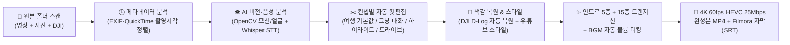

# 🎬 AutoCut Studio 2026

> **"일일이 컷 편집하기 귀찮아서 만들었어요."**  
> 영상과 사진의 메타데이터·비전(흔들림/선명도/얼굴)·음성(한국어 대화)을 스스로 분석해서, **기본 컨셉(`여행`, `그냥 대화` 등)만 골라주면 알아서 컷 편집·색보정(DJI D-Log)·자막·트랜지션·배경음악·4K 60fps HEVC 인코딩까지 끝내주는 AI 자동 영상 편집 스튜디오**입니다.

- **Author GitHub**: [https://github.com/geniuth](https://github.com/geniuth)
- **Repository**: [https://github.com/geniuth/autocut](https://github.com/geniuth/autocut)
- **Current Version**: `v2.2.0` — 변경 이력은 [CHANGELOG.md](CHANGELOG.md) 참고 (Semantic Versioning)

---

## 🤖 0. 기본 AI 모델 스택 (v2.2.0)

| 역할 | 기본 모델 | 사용처 |
| :--- | :--- | :--- |
| 🎙️ 음성 인식 + VAD | **Faster-Whisper large-v3-turbo** | 한국어 대화 자막, 말소리 구간 보존 |
| 🌟 미학 점수 / 베스트 샷 | **CLIP Aesthetic Predictor (SigLIP / LAION-Aesthetics V2.5)** | 컷 후보 점수화, 인트로 베스트 샷 선정 |
| ✂️ 샷 경계 검출 | **TransNetV2 / PySceneDetect ContentDetector** | 컷 경계 스냅, 유튜브 스타일 학습의 컷 템포 측정 |
| 🧠 멀티모달 장면 이해 | **Qwen2.5-VL (7B) / InternVL 2.5** | 장면 캡션(자막 태그), 하이라이트 점수 |

- **VRAM 순차 관리 (8GB GPU 대응)**: Whisper 전체 처리 → 모델 해제 → CLIP/VLM 분석 → 해제 → NVENC 4K 인코딩 순서로 실행됩니다.
- **Qwen2.5-VL / InternVL**: 로컬 Ollama(`qwen2.5vl`, `internvl`)가 있으면 사용하고, 없으면 CUDA zero-shot 장면 분류기로 자동 대체되어 렌더링이 멈추지 않습니다.
- 분석 리포트 JSON에 `version`, `ai_models`, `aesthetic_mean`, `shot_boundaries`, `vlm_caption`, `vlm_highlight_score`가 기록됩니다.

---

## 💡 1. 왜 만들었나요? (제작 동기)

여행을 다녀오거나 아이들과 일상을 보내고 나면 스마트폰, 액션캠, 드론(DJI)에 수십~수백 개의 동영상과 사진이 쌓입니다.  
막상 추억 영상으로 남기려고 편집 프로그램을 켜면:
1. 영상을 하나씩 돌려보며 **바닥이 찍히거나 심하게 흔들린 구간, 아무 말 없는 침묵 구간을 일일이 자르고**,
2. **사진과 동영상 촬영 순서를 맞추고**, 뒤집힌 사진 방향을 바로잡고,
3. 대화 소리를 들어보며 **자막을 타이핑하고**,
4. **배경음악(BGM)**을 깔아둔 뒤 말할 때는 줄이고 사진 나올 때는 키우는 볼륨 키프레임을 찍고,
5. **DJI D-Log**로 찍은 물 빠진 영상을 일일이 색보정(LUT)하는 과정이 **너무 번거롭고 귀찮아서** 결국 원본 파일을 외장하드에 방치하게 됩니다.

그래서 **"폴더만 지정하고 기본 컨셉(`여행` 또는 `그냥 대화`)만 선택하면, AI가 알아서 다 분석해서 4K 60fps 완성본 영상과 필모라(Filmora) 프로젝트용 파일까지 원클릭으로 만들어주는 프로그램"**을 직접 만들었습니다.

---

## 🧠 2. 핵심 컨셉 (알아서 분석하고 편집·인코딩하는 파이프라인)

사용자는 **촬영 폴더**와 **편집 모드(컨셉)**만 선택하면 됩니다. 나머지는 엔진이 전 과정을 자동으로 수행합니다.



### ✂️ 영상 편집 모드 (4가지 기본 컨셉 지원)
| 편집 모드 | 설명 및 컷 편집 알고리즘 |
| :--- | :--- |
| **🏝️ 여행 (기본값, `travel`)** | **풍경·인물 베스트 컷 + 현장 대화의 조화** — 대화 구간은 문장이 끊기지 않게 살리고(앞뒤 `0.5초` 여유), 말 없는 구간도 선명하고 안정적인 풍경·인물 하이라이트(`최대 6.5초`)를 골라 여유 있게 연결합니다. |
| **💬 그냥 대화 (`talk`)** | **일상 토크·가족 대화 중심** — 말소리(Speech)가 있는 모든 구간을 최우선으로 보존하며(`0.6초` 여유, 인접 대화 자동 병합), 말 없는 침묵 구간은 핵심 표정·리액션 위주로 짧게(`최대 2.5초`) 덜어내어 텐션감 있게 대화를 이어 붙입니다. |
| **⚡ 하이라이트 요약 (`highlight`)** | **핵심 대화 + 베스트 장면 빠른 템포** — 긴 원본 영상을 3~5분 내외로 빠르게 요약할 때 적합합니다 (`최대 무음 컷 3.5초`). |
| **🚗 드라이브·풍경 감상 (`drive`)** | **이동·해안도로·풍경 롱테이크 비중 확대** — 대화뿐만 아니라 흔들림 없이 안정적인 주행·자연 풍경 구간을 길게(`최대 9.0초`) 살려 감상용으로 편집합니다. |

---

## ✨ 3. 인트로 종류 (5가지 디자인 + 랜덤 선택)

전체 영상과 사진 중 **초점 선명도(Laplacian Variance), 노출 밸런스, 색채 채도, 인물 얼굴 구도(Haar Cascade), 상하 정방향 여부**를 종합 채점해 가장 잘 나온 **베스트 샷(Best Shot)**을 뽑아 **3.0초 오프닝 인트로**를 생성합니다.  
취향에 따라 **5가지 인트로 디자인 중 하나를 직접 고르거나 `랜덤`으로 선택**할 수 있습니다.


1. **클래식 화이트 프레임 (`classic_frame` — 기본값)**: 정방향 베스트 샷 위에 이중 화이트 라운드 프레임과 반투명 네이비 타이틀 박스를 배치한 깔끔한 디자인
2. **시네마틱 레터박스 (`cinematic_bar`)**: 영화관 비율의 상·하단 블랙 레터박스와 골드 라인, 중앙 와이드 시네마 타이틀을 배치한 영화풍 오프닝
3. **매거진 에디토리얼 (`magazine_lower`)**: 화면 중앙의 피사체를 가리지 않도록 좌측 하단에 스카이 포인트 라인과 매거진 배너 카드를 배치한 감성 디자인
4. **미니멀 글래스 카드 (`minimal_glass`)**: 모던한 반투명 프로스트 글래스 카드와 상단 블루 캡슐 로고 뱃지를 조합한 트렌디 디자인
5. **폴라로이드·다이어리 스탬프 (`vlog_stamp`)**: 따뜻한 아이보리 폴라로이드 액자 테두리와 좌상단 `REC ● 날짜` 스탬프, 하단 다이어리 캡션을 넣은 브이로그 디자인
6. **랜덤 인트로 스타일 (`random`)**: 날짜 폴더를 편집할 때마다 위 5가지 디자인 중 하나를 자동으로 선택

---

## 🔀 4. 트랜지션 종류 (총 15종 내장 + 예시 그림)

컷과 컷이 바뀔 때 화면이 뚝뚝 끊기지 않도록 앞 클립의 마지막 프레임을 추출해 뒷 클립 시작부와 **0.45초 동안 부드럽게 오버랩(`FFmpeg xfade`)**합니다. 총 **15종류의 트랜지션**이 내장되어 있으며, 마지막 장면에는 `1.2초` 블랙 페이드아웃이 자동 적용됩니다.


| 번호 | 트랜지션 코드 | 한글 명칭 | 전환 연출 특징 |
| :---: | :--- | :--- | :--- |
| **01** | `fade` | 페이드 오버랩 | 앞 장면과 뒷 장면이 부드럽게 겹치며 가장 자연스럽게 전환 |
| **02** | `dissolve` | 필름 디졸브 | 미세한 입자감으로 이전 장면이 녹아들며 다음 장면으로 전환 |
| **03** | `wipeleft` | 와이프 레프트 (←) | 오른쪽에서 왼쪽으로 화면을 닦아내듯 전환 |
| **04** | `wiperight` | 와이프 라이트 (→) | 왼쪽에서 오른쪽으로 화면을 닦아내듯 전환 |
| **05** | `slideleft` | 슬라이드 레프트 (⇐) | 다음 클립이 오른쪽에서 왼쪽으로 미끄러지듯 들어오며 전환 |
| **06** | `slideright` | 슬라이드 라이트 (⇒) | 다음 클립이 왼쪽에서 오른쪽으로 미끄러지듯 들어오며 전환 |
| **07** | `circleopen` | 서클 오픈 (○↗) | 화면 중앙에서 원형 조리개가 바깥으로 열리며 다음 장면 등장 |
| **08** | `circleclose` | 서클 클로즈 (○↘) | 바깥에서 중앙으로 원형이 닫히며 다음 장면으로 전환 |
| **09** | `smoothleft` | 스무스 레프트 | 경계면이 부드럽게 블러(Feather) 처리되며 좌측으로 흐르듯 전환 |
| **10** | `smoothright` | 스무스 라이트 | 경계면이 부드럽게 블러 처리되며 우측으로 흐르듯 전환 |
| **11** | `smoothup` | 스무스 업 (↑) | 아래에서 위로 부드럽게 쓸어 올리듯 전환 |
| **12** | `smoothdown` | 스무스 다운 (↓) | 위에서 아래로 부드럽게 쓸어 내리듯 전환 |
| **13** | `radial` | 래디얼 회전 (↻) | 시계 바늘이 회전하듯 360도 스윕하며 장면 전환 |
| **14** | `diagtl` | 다이어고널 TL (↖) | 우하단에서 좌상단 대각선 방향으로 가로지르며 전환 |
| **15** | `diagbr` | 다이어고널 BR (↘) | 좌상단에서 우하단 대각선 방향으로 가로지르며 전환 |

---

## 🚁 5. DJI 드론·액션캠 & D-Log / D-Log M 자동 색보정

DJI 드론(Mavic 3 / Air 3 / Mini 4 Pro 등)이나 Osmo Action / Osmo Pocket으로 촬영한 **D-Log / D-Log M (10-bit)** 영상은 후보정을 전제로 촬영되어 원본 그대로 두면 물 빠진 회색빛(Flat)으로 보입니다.


- **자동 감지 (`auto` — 기본값)**: 파일명(`DJI_*`), FFprobe 컬러 메타데이터, **10-bit 픽셀 포맷(`yuv420p10le`)**, 프레임 평균 대비(`std < 43`) 및 채도(`sat < 68`)를 분석해 **D-Log / D-Log M 영상만 골라서 자동으로 Rec.709 S-커브 톤 매핑과 채도 복원 필터를 적용**합니다. (일반 스마트폰 영상과 한 폴더에 섞여 있어도 D-Log 영상만 정확히 복원합니다!)
- **수동 강제 지정도 지원**: `DJI D-Log M (10-bit) 전용 복원`, `DJI D-Log (Mavic/Air 프로파일) 복원`, `액션캠/고프로 Flat 생생하게` 중 직접 선택 가능

---

## 🎵 6. 배경음악 (BGM 자동 생성 & 스마트 볼륨 더킹)

유튜브 업로드 시 저작권 걱정 없이 사용할 수 있는 **잔잔한 어쿠스틱 피아노 & 앰비언트 패드 배경음악(`calm_family_bgm.wav`)**을 자체 신디사이저로 생성·내장하고 있으며, 클립 종류에 따라 **자동 볼륨 더킹(Dynamic Volume Ducking)**이 동작합니다.

- **동영상 클립 재생 중 (현장 대화 우선)**:
  - 현장 오디오의 주행 소음·바람 소리를 제거(`highpass=85Hz` + `afftdn`)하고 방송 표준 음압(`loudnorm -16 LUFS`)으로 맞춘 뒤, **배경음악은 `6%`로 아주 작게** 깔아 대화 소리가 선명하게 들리도록 합니다.
- **인트로(3초) 및 사진 슬라이드(3초) 재생 중 (감성 연출)**:
  - 현장 대화가 없는 구간이므로 **배경음악을 `38%` 보통 크기로 자연스럽게 키워** 앞뒤 페이드인/아웃과 함께 감성적인 분위기를 연출합니다.

---

## 📅 7. 동영상과 사진은 어떻게 배치하나요? (파일 내 메타데이터 분석)

폴더 안에 동영상(`.mp4`, `.mov`, `.mkv` 등)과 사진(`.jpg`, `.jpeg`, `.png`, `.heic` 등)이 섞여 있어도 파일 이름이 아닌 **파일 내부의 실제 촬영 시각 메타데이터**를 정밀 분석하여 **초 단위 시간순(Chronological Order)**으로 한 타임라인에 배치합니다.

1. **동영상 촬영 시각 추출 (`get_video_datetime_iso`)**:
   - `ffprobe`로 영상 컨테이너 내부의 `com.apple.quicktime.creationdate`(애플/아이폰 로컬 타임존 포함) 및 표준 `creation_time`(UTC 태그 감지 시 한국 시간 `KST +09:00`로 자동 변환)을 읽어 정확한 촬영 시각을 확보합니다.
2. **사진 EXIF 촬영 시각 추출 (`get_photo_datetime_iso`)**:
   - `Pillow`로 사진 내부의 `EXIF Tag 36867 (DateTimeOriginal)` 및 `Tag 306 (DateTime)`을 읽어 실제 셔터를 누른 시각을 추출합니다.
3. **상하 반전 자동 보정 & 블러 프레임**:
   - EXIF 회전 태그 보정(`ImageOps.exif_transpose`)은 물론, 메타데이터 없이 거꾸로 저장된 사진/영상도 **상·하단 하늘 밝기/블루 비율 및 정방향/역방향 얼굴 검출 비교**를 통해 위아래가 뒤집히지 않도록 자동 보정합니다.
   - 세로 사진이나 비율이 다른 사진은 배경에 은은한 가우시안 블러(`GaussianBlur`)와 화이트 테두리를 입혀 **3.0초 슬라이드 클립**으로 자연스럽게 이어 붙입니다.

---

## ⚙️ 8. 기본 출력 인코딩 사양 (4K 60fps HEVC 25Mbps)

고화질 원본 영상과 드론/아이폰 4K 촬영본의 디테일을 손실 없이 보존하기 위해 기본 출력 사양이 최고 수준으로 설정되어 있습니다 (GUI에서 언제든 변경 가능).

- **출력 해상도 ( 기본값 )**: `3840x2160 (4K UHD)` *(2560x1440 QHD, 1920x1080 FHD, 1280x720 HD 선택 가능)*
- **프레임 레이트 ( 기본값 )**: `60 fps` *(30 fps, 24 fps 선택 가능)*
- **압축 코덱 ( 기본값 )**: `HEVC (H.265 — NVIDIA NVENC 하드웨어 가속 hevc_nvenc + Apple/Windows 호환 hvc1 태그)`
- **출력 화질 ( 기본값 )**: `25,000,000 bps (25 Mbps)` *(평균 비트레이트 `-b:v 25M` + 최대 피크 `37.5M` VBR HQ 제어)*

---

## 🚀 9. 실행 방법 및 결과물

### 필수 환경
- Windows 10 / 11 (64-bit), Python 3.10+, FFmpeg (`hevc_nvenc` 지원 권장), NVIDIA GeForce RTX GPU 권장
- 주요 패키지 설치:
  ```bash
  pip install faster-whisper opencv-python pillow numpy yt-dlp
  ```

### 실행 방법
- 바탕화면 또는 폴더 내 **`AutoCut_Studio.vbs`** 더블클릭 (콘솔 창 없이 즉시 GUI 실행)
- 또는 터미널에서 직접 실행:
  ```bash
  python autocut_gui.py
  ```

### 생성되는 결과물 (`편집결과_날짜/` 폴더)
1. **`날짜_자막포함_완성본.mp4`**: 3초 인트로 + 시간순 영상/사진 컷 편집 + DJI D-Log 색보정 + 15종 트랜지션 + BGM 자동 더킹 + 하드코딩 자막이 모두 포함된 즉시 감상·유튜브 업로드용 4K 60fps HEVC MP4
2. **`날짜_무자막_필모라용.mp4`**: 필모라(Wondershare Filmora) 등 편집기에서 자막 문구만 자유롭게 수정할 수 있는 클린 영상
3. **`날짜_전체자막(필모라용).srt` & `날짜_음성자막(필모라용).srt`**: 필모라 타임라인에 드래그 앤 드롭하면 컷 편집 싱크에 100% 맞춰 올라가는 자막 파일
4. **`날짜_베스트샷.jpg`**: 3초 인트로에 선정된 정방향 베스트 샷 원본 이미지
5. **`날짜_편집분석리포트.json`**: 클립별 촬영 시각, 컷 구간, 음성 인식 결과를 담은 캐시 리포트 (사진 추가 후 재실행 시 기존 영상 분석을 1초 만에 통과!)
